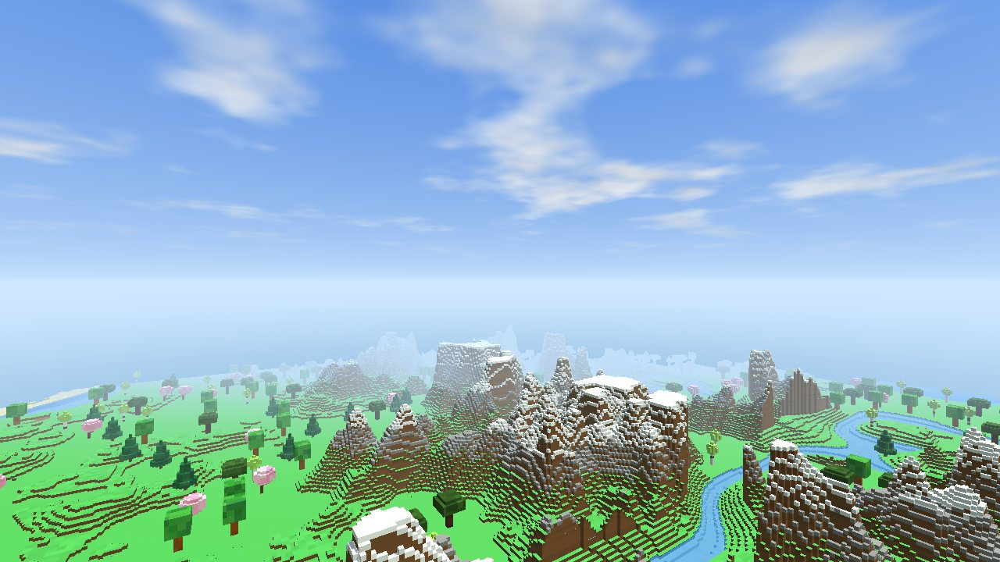
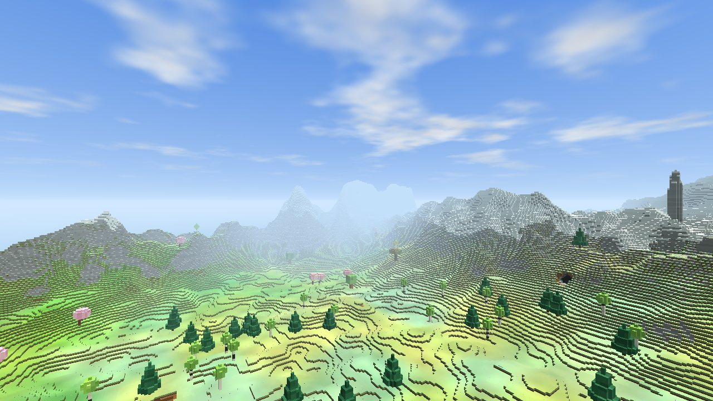
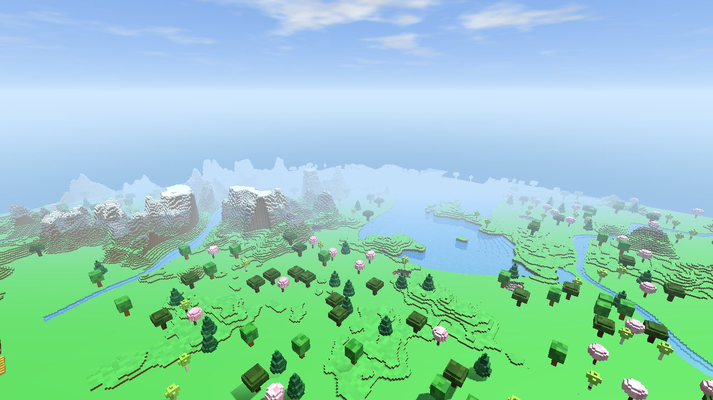
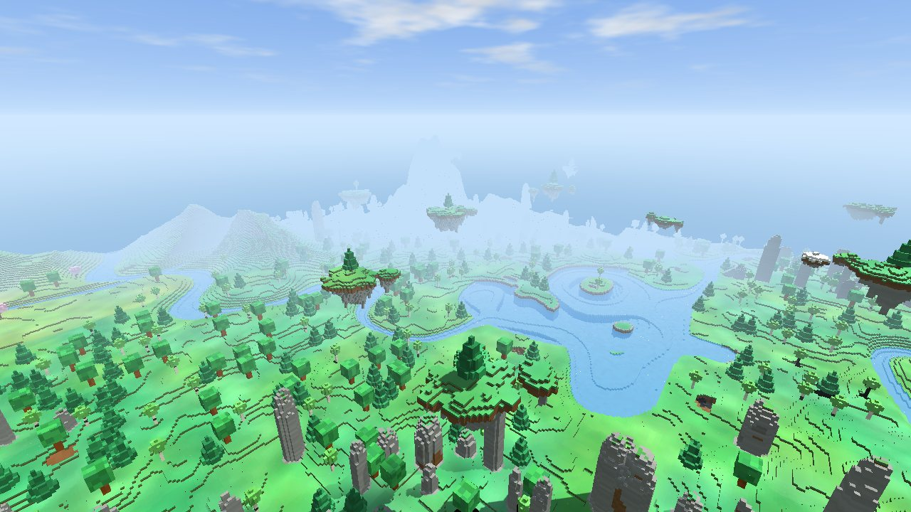
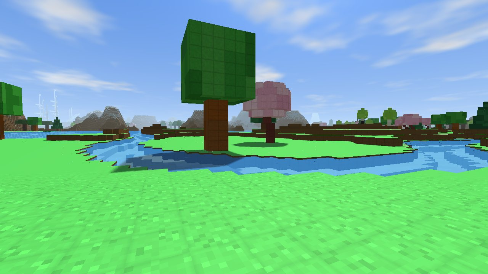
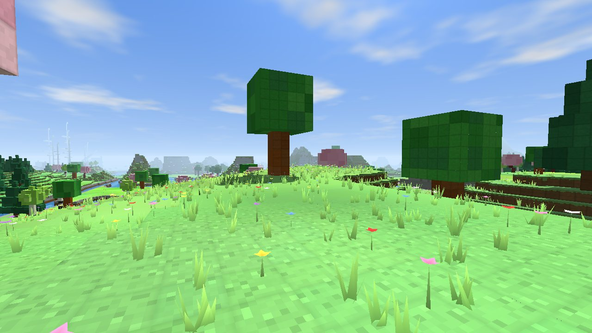
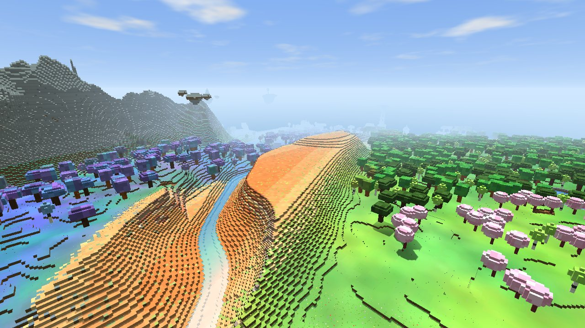
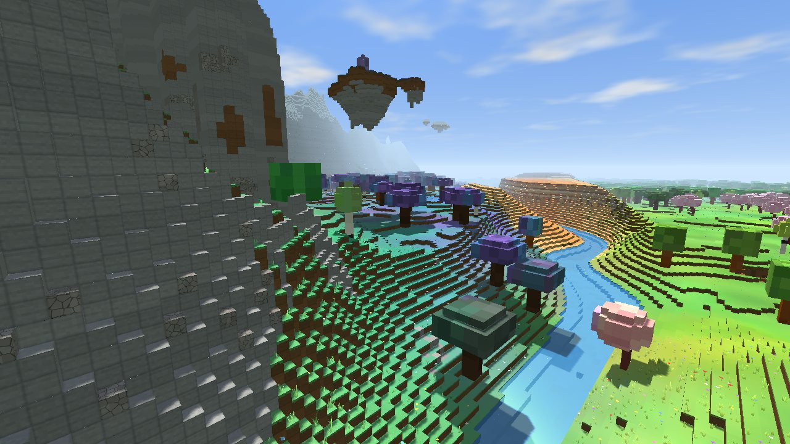
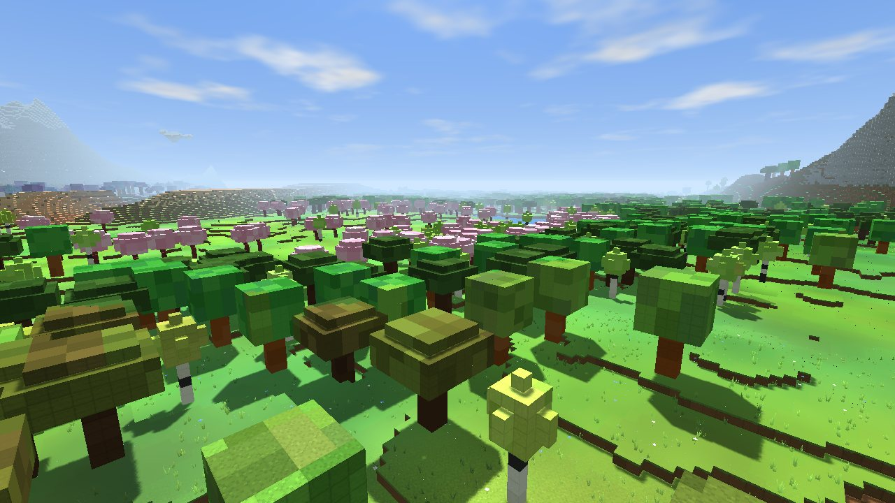

# Новая генерация мира (версия 5)

Скриншоты сняты в игре (браузер, сид мира 12345, прорисовка «максимальная», полдень).
«До» — прежняя генерация (версия 4), «после» — новая (версия 5), с тех же точек.

| | До | После |
|---|---|---|
| Горы издалека |  |  |
| Вид с высоты, в полёте |  |  |
| Трава вблизи |  |  |

Новые края:

| Алые каньоны | Лунная роща | Вишнёвая долина |
|---|---|---|
|  |  |  |

Что изменилось:

- Горы — длинные хребты с острыми вершинами до ~110 м (раньше потолок 36 м и плоский срез).
  Мир теперь высотой 120 слоёв, вершины выше 96 м лишь чуть замедляют рост — «потолка» нет.
  Наверху снег (ниже — в холодных краях), на обрывах и крутых склонах — голая скала,
  между хребтами — долины, по ним текут реки.
- Края мира плавно переходят друг в друга, у каждого своя трава и листва: цветущие луга, леса,
  золотая осень, вишнёвые долины, пышные заросли, тайга, золотая степь, холодные нагорья.
  Далеко от начала — волшебные края: лунные рощи, алые каньоны, расколотые скалы и парящие острова.
- Трава с переливами: пятна светлее и темнее, тёплые и холодные оттенки; на склонах бахрома травы
  над землёй. Вокруг игрока — высокая трава разной высоты и цветы (сквозь них ходишь, как в жизни).
- Старые сохранённые миры не меняются: у каждого мира записана его версия генерации.
